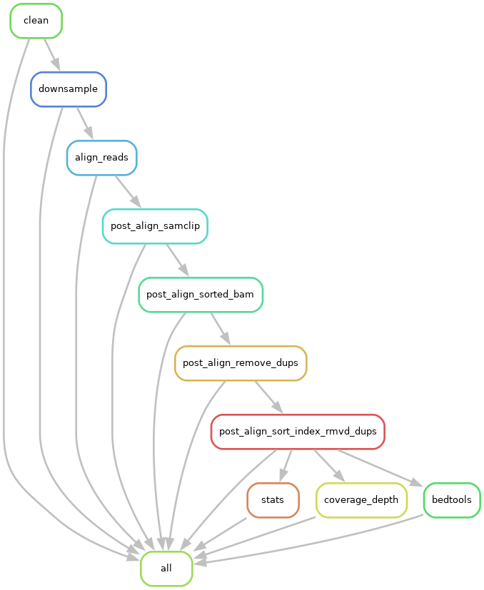

# SNPkit

Snakemake workflow for microbial variant calling, recombination detection and phylogenetic tree reconstruction.

<!--### Summary -->


## Installation

<!--### Clone snpkit repository onto your system.-->

Ensure you are cloning the repository in your scratch directory. The path should look something like this: `/scratch/esnitkin_root/esnitkin1/your_uniqname/` 

> Clone the github directory onto your system.

```
git clone https://github.com/Snitkin-Lab-Umich/snpkit-smk.git
```

> Ensure you have successfully cloned snpkit. Type `ls` and you should see the newly created directory `snpkit-smk`. Move to the newly created directory.

```

cd snpkit-smk

```

<!--### Load necessary modules to run snpkit-->

> Load necessary modules from Great Lakes modules.

```
module load Bioinformatics
```

```
module load snakemake singularity htslib
```

This workflow makes use of singularity containers available through [State Public Health Bioinformatics group](https://github.com/StaPH-B/docker-builds). If you are working on Great Lakes (umich cluster)—you can load snakemake and singularity modules as shown above. However, if you are running it on your local or other computing platform, ensure you have snakemake and singularity installed.

## Modify config and sample files and set up files for use as reference genome 

<!--###**_If you are just testing this pipeline, the config and sample files are already loaded with test data, so you do not need to make any additional changes to them. However, it is a good idea to change the prefix variable (i.e. name of your output folder) in the config file to give you an idea of what variables need to be modified when running your own samples on snpkit._**-->

### Config
As an input, the snakemake file takes a config file where you can set the path to `samples.tsv`, path to your raw sequencing reads, path to adapter fasta file etc. Instructions on how to modify `config/config.yaml` is found in `config.yaml`. 

### Samples
Add samples to `config/samples.tsv` following the explanation provided below. `samples.tsv` should be a comma seperated file consisting of one columns: `sample_id`.

* `sample_id` is the prefix that should be extracted from your FASTQ reads. For example, in  your raw FASTQ files directory, if you have a file called `Rush_KPC_110_R1.fastq.gz`, your sample_id would be `Rush_KPC_110`.


You can create `samples.tsv` file using the following for loop. Replace *path_to_your_raw_reads* below with the actual path to your raw sequencing reads.

```

echo "sample_id" > config/samples_test.tsv

```

```

for read1 in path_to_your_raw_reads/*_R1.fastq.gz; do
    sample_id=$(basename $read1 | sed 's/_R1.fastq.gz//g')
    echo $sample_id
done >> config/samples_test.tsv

```

### Setup files needed for reference genome

#### Setup snpEff database

Before you run snpkit, it is essential to establish a snpEff database tailored to your reference genome.<!-- Refer to the documentation [here](snpEff.md) for detailed instructions on creating the database. -->

<!--# Setting up snpEff database
By following these steps, you'll ensure that your snpEff database is correctly configured for subsequent usage with snpkit. -->


#### 1. Create a directory

> First, create a directory named after your reference genome within the designated *reference* directory.
For instance, if your reference genome is **KPNIH1**, create a directory named `KPNIH1` within `reference`.
```

mkdir reference/KPNIH1

```

#### 2. Upload Genbank and GFF files

Upload the corresponding genbank (.gbk) and GFF (.gff) files into the newly created directory. You can download the files from NCBI, check if your reference genome of interest can be found in this path `/nfs/esnitkin/bin_group/variant_calling_bin/reference` and move it to the `reference` folder or if your reference genome is t.
  

#### 3. Rename Genbank and GFF files
After uploading the files, it's crucial to rename them to ensure they are compatible with snpEff.

> Rename the genbank file to _**genes.gbk**_. For example, if your genbank file is named *KPNIH1.gbk*, rename it to ***genes.gbk***.

```

mv KPNIH1.gbk genes.gbk

```
    
> Similarly, rename the GFF file to ***genes.gff***. For instance, if your GFF file is named *KPNIH1.gff*, rename it to ***genes.gff***.

```

mv KPNIH1.gff genes.gff

```
### Index your reference genome using bwa

Generating the necessary files to prepare a fasta to use as reference is required for **BWA** (aligner used in this pipeline) and **GATK**. 

Indexing a genome can be compared to indexing a book. To find the page where a specific word appears or where a chapter begins, it's far more efficient to consult a pre-built index than to flip through every page until you locate it. The same principle applies to alignments. Indices help the aligner quickly pinpoint the likely location of a query sequence within the genome, thereby saving both time and memory. 

**Read about why indexing is important [here](https://www.biostars.org/p/407038/) and why we need all the following [files](https://www.biostars.org/p/375837/) for variant calling.**

> Load bwa module
```

module load bwa

```

> Generate index files with `bwa index`

```

bwa index your_reference_genome.fasta

```

### Generate `.fai` index file for your reference genome using samtools

The [difference](https://www.biostars.org/p/9237/) between `bwa index` and indexing with `samtools faidx`

>Load samtools module
```
module load samtools
```

> Generate `.fai` index file
```

samtools faidx your_reference_genome.fasta

```

### Generate `.dict` dictionary file for your reference genome using GATK

The `.dict` file will list the contig names and sizes based on the reference genome.

>Load GATK module

```

module load gatk

```

> Generate `.dict` file 

```

gatk CreateSequenceDictionary -R your_reference_genome.fasta

```


## Quick start

### First step in the pipeline

> Preview the steps in snpkit by performing a dryrun of the pipeline. 

```

snakemake -s snpkit.smk --dryrun -p

```

> Run snpkit on Great lakes HPC

```

snakemake -s snpkit.smk -p --use-conda --use-singularity -j 999 --cluster "sbatch -A {cluster.account} -p {cluster.partition} -N {cluster.nodes}  -t {cluster.walltime} -c {cluster.procs} --mem-per-cpu {cluster.pmem}" --conda-frontend conda --cluster-config config/cluster.json --configfile config/config.yaml --latency-wait 1000

```

### Second step in the pipeline
Run the second part of the pipeline only after successfully completing the run 

>Start an interactive session in your current directory i.e. `snpkit-smk`.

```

srun --account=esnitkin1 --nodes=1 --ntasks-per-node=1 --mem-per-cpu=5GB --cpus-per-task=1 --time=12:00:00 --pty /bin/bash

```

> Activate snpkit conda environment

```

conda activate /nfs/turbo/umms-esnitkin/conda/snpkit/

```

> Install package required for parsing of VCF files

```

pip install cyvcf2

```


> Final step of the pipeline is to generate SNP/indel matrices. Follow the steps below:

<!--If you would like to run it interactively do `bash path/to/sbat/script.sbat`
/gpfs/accounts/esnitkin_root/esnitkin1/dhatrib/snpkit-smk/results/2024-05-22_snpkit-smk//core_temp_dir//2024_05_24_11_43_06_Test_Snpkit_Parser_core_All.sbat -->

1. replace `/path/to/snpkit.py` with the path to where your `snpkit.py` script is. It should look something like this:  `your_uniqname` is your uniqname `/gpfs/accounts/esnitkin_root/esnitkin1/your_uniqname/snpkit-smk/python_scripts/snpkit_parser/snpkit.py`. 

2. Edit `config`  in `snpkit-smk/python_scripts/snpkit_parser/config`. Scroll down until you see `[index]` and see how index is called. Follow the same format as the other reference genomes specified in that section and edit the config with the reference genome of your choice. 

3. replace `path/to/your/reads/directory` with the path to your sequencing reads. 

4. replace `your_results_output_directory` with where you would like to output the results of this run. Ideally, you would want it in the same folder as the output from the first step i.e. `/snpkit-smk/results/date_of_your_run_snpkit-smk/`

```

python3 /path/to/snpkit.py -type PE -index your_index -readsdir path/to/your/reads/directory -steps parse -analysis Test_Snpkit_Parser -outdir your_results_output_directory -cluster cluster -scheduler SLURM -gubbins yes -mask

```

**An example of how the above command would look like**

```
python3 /gpfs/accounts/esnitkin_root/esnitkin1/dhatrib/snpkit-smk/python_scripts/snpkit_parser/snpkit.py -type PE -index KPNIH1 -readsdir /nfs/turbo/umms-esnitkin/Github/test_data/fastq -steps parse -analysis Test_Snpkit_Parser -outdir /gpfs/accounts/esnitkin_root/esnitkin1/dhatrib/snpkit-smk/results/2024-05-29_snpkit-smk/ -cluster cluster -scheduler SLURM -gubbins yes -mask

```
<!--THE DAG BELOW NEEDS TO BE UPDATED TO INCLUDE THE SECOND STEP OF THE PIPELINE -->


